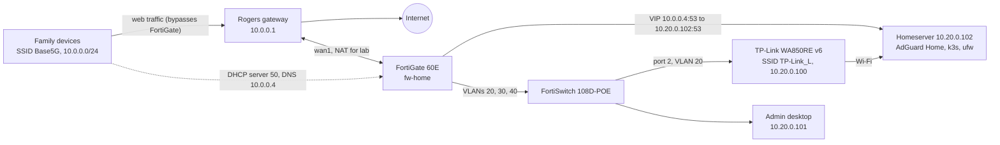
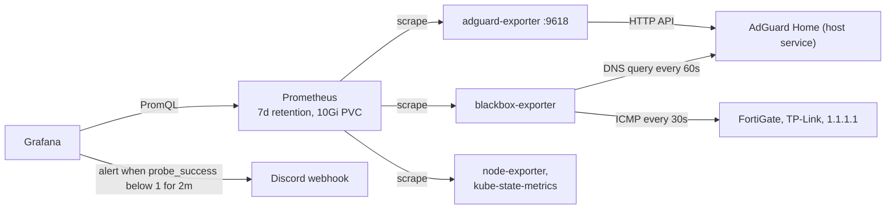

# Sinkhole

Segmented home security lab: FortiGate VLAN segmentation, network-wide DNS filtering with AdGuard Home, and a single-node k3s monitoring stack (Prometheus, Grafana) that alerts to Discord when a device or DNS goes down.

**Stack:** FortiGate 60E, FortiSwitch 108D-POE, AdGuard Home, k3s, Helm, kube-prometheus-stack, Prometheus Blackbox Exporter, Grafana, ufw

## Goal

- Segment the home network so lab VLANs cannot reach the family network
- Filter DNS for every household device without putting family devices on the lab Wi-Fi
- Harden the firewall and the server that runs DNS and monitoring
- See outages quickly: dashboards plus an alert when a target or DNS stops answering
- Use only gear already owned and free software

## Architecture

### Network and DNS

- Family traffic goes device, Rogers gateway, ISP. The FortiGate only serves family devices DHCP and DNS.
- Lab traffic goes VLAN, FortiGate (NAT), Rogers gateway, ISP.
- Policy 8 (`vlan20-block-home`) blocks VLAN 20 from reaching 10.0.0.0/24.

### Monitoring pipeline

Arrows point from the component that starts the request. AdGuard runs on the host. Everything else in the monitoring pipeline runs in k3s (namespace `monitoring`).

## How it works

| Stage | Input | Output |
|---|---|---|
| adguard-exporter | AdGuard HTTP API (credentials in a Kubernetes Secret) | AdGuard metrics on :9618 |
| blackbox-exporter | Probe `lab-ping` (10.20.0.1, 10.20.0.100, 1.1.1.1, 30s) and `lab-dns` (example.com A against 10.20.0.102:53, 60s) | `probe_success` per target |
| Prometheus | ServiceMonitors and Probes labelled `release: kps` | 7 days of metrics |
| Grafana | PromQL | Dashboards (AdGuard dashboard 20799) and alert rules |
| Alert | `probe_success` below 1 for 2m, evaluated every 1m, no data counts as Alerting | Discord message through the contact point |

## Security controls

- FortiGate admin reachable only from one lab host. SSL VPN off. wan1 allows ping only.
- Homeserver ufw: default deny incoming, SSH and the AdGuard UI only from the admin desktop, DNS open, pod network allowed for k3s.
- Lab VLAN 20 cannot reach the family network (policy 8).
- Grafana and Prometheus are never exposed. Access is an SSH tunnel plus `kubectl port-forward`.
- No credentials in this repo. The AdGuard login lives in a Kubernetes Secret and the Discord webhook is set in the Grafana UI.

## Results

- Four probe targets reporting `probe_success = 1` (FortiGate, TP-Link, 1.1.1.1, AdGuard DNS)
- Alert path tested end to end: scaling the blackbox exporter to zero produced a Discord message, and scaling it back cleared it
- AdGuard filtered 21.8% of DNS queries at the time of capture (October 2026)
- DNS upstreams use DoH (Cloudflare and Quad9)

## Lessons learned

- **Grafana OOM kill:** a 384Mi memory limit was too low. The kernel log showed `Memory cgroup out of memory`. Raised the limit to 1Gi and the request to 256Mi, and kept it in the values file.
- **Exporter 401 errors:** the exporter used the wrong AdGuard username. Validated the login with `curl` before recreating the Secret.
- **No alert on first test:** the rule's "no data" state was `NoData`. Setting it to Alerting made the outage test fire.
- **Pasted `read` prompts:** a `sudo` prompt swallowed pasted lines and created an empty password in the Secret. Run `read` lines one at a time.
- **Wi-Fi idle kicks:** the access point disconnected the idle server (`DISASSOC_DUE_TO_INACTIVITY`). A keepalive ping service reduces it. A cable removes it.

## Known limits

- Monitoring runs on the machine it monitors, so a full homeserver outage sends no alert.
- The homeserver is on Wi-Fi, which is the weakest link.
- Family DNS coverage is partial: the Rogers gateway also runs DHCP and pushes IPv6 DNS that skips AdGuard.
- Lab VLANs have no DNS fallback.
- Single node, no backups of cluster volumes.

## Roadmap

- Cable the homeserver
- FortiGate SNMP exporter and syslog into Loki
- Fallback DNS for the lab VLANs
- IPsec tunnel (strongSwan, IKEv2) to a free-tier VPS
- Back up cluster volumes and device configs

## Repo layout

| Path | Contents |
|---|---|
| `helm/monitoring-values.yaml` | kube-prometheus-stack values |
| `k8s/` | adguard-exporter, blackbox-exporter, probes |
| `host/` | k3s install, ufw rules, Wi-Fi keepalive unit |
| `fortigate/` | DHCP server reference config |
| `docs/` | alerting setup and access |
| `scripts/export-live-manifests.sh` | exports the live cluster objects to YAML |

The manifests are reference copies written from the build notes. Run `scripts/export-live-manifests.sh` on the server to capture the exact live state.
